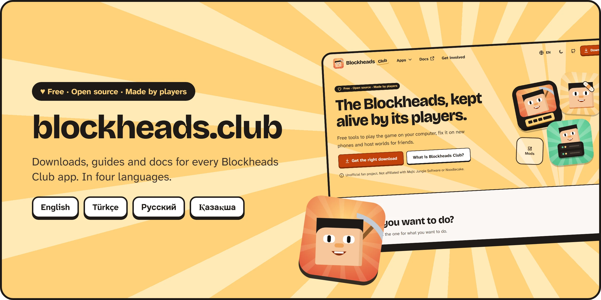
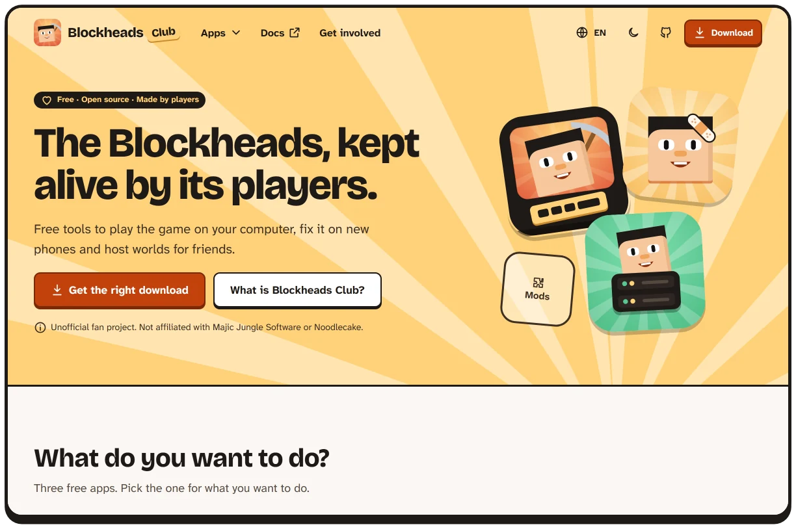
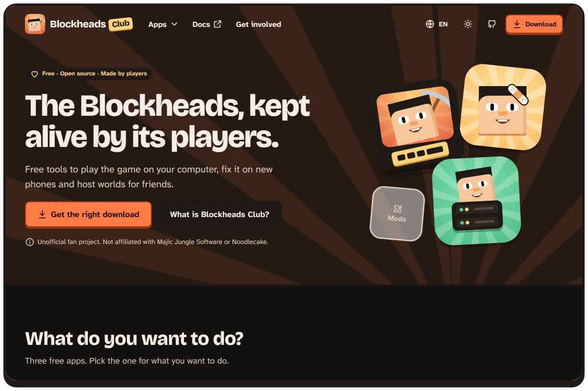
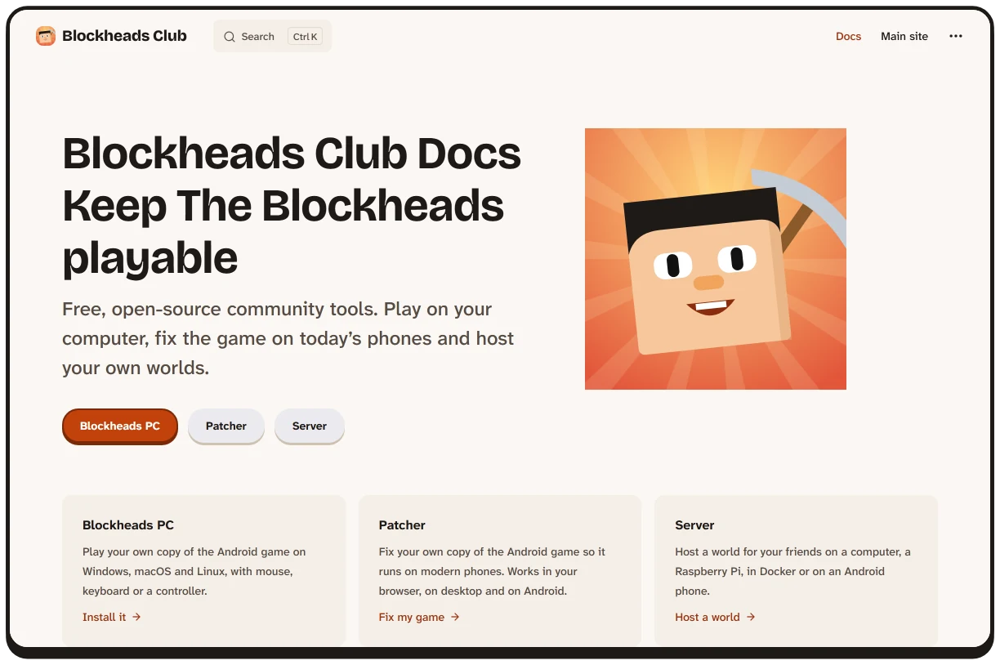
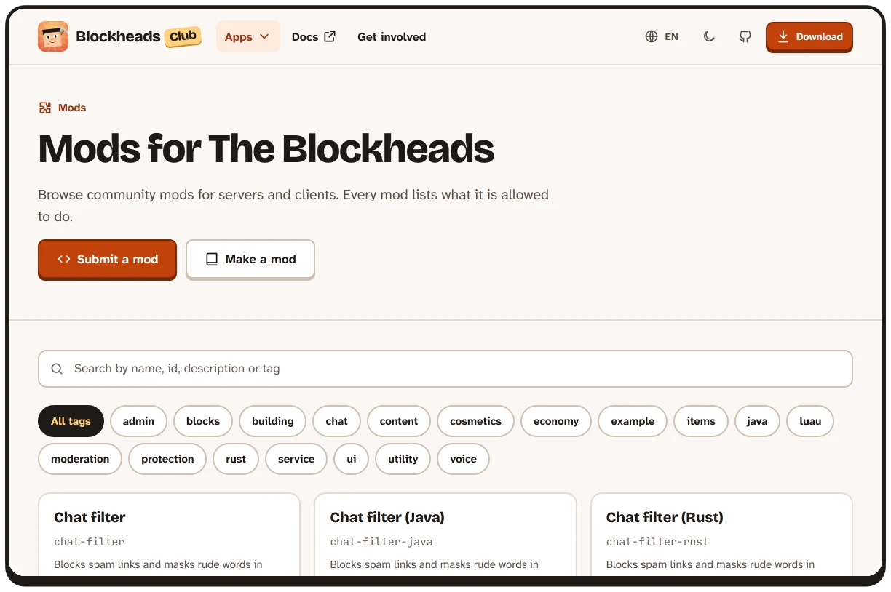
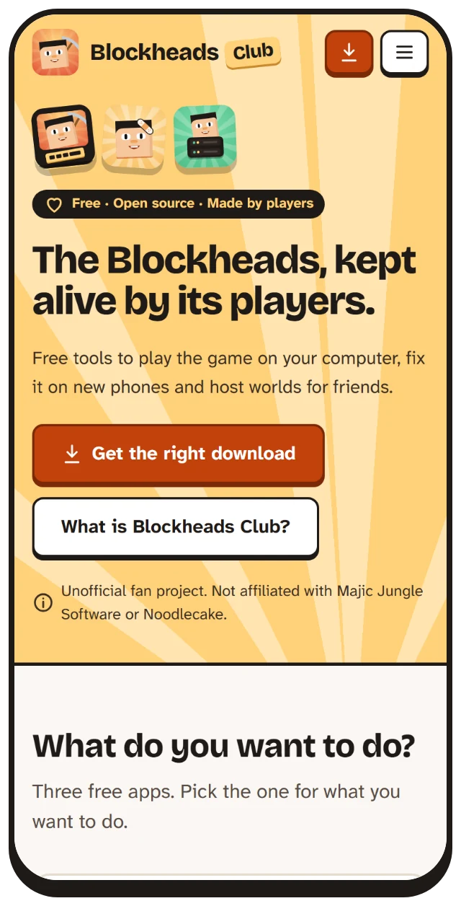

<p align="center">
  <a href="https://blockheads.club/">
    
  </a>
</p>

<p align="center">
  <a href="https://blockheads.club/"></a>
  <a href="https://github.com/Blockheads-Club/website/releases"></a>
  <a href="https://github.com/Blockheads-Club/website/actions/workflows/ci.yml"></a>
  <a href="LICENSE"></a>
</p>

<h3 align="center">
  <a href="https://blockheads.club/">🌐 Website</a>
  &nbsp;·&nbsp;
  <a href="https://blockheads.club/docs/">📖 Docs</a>
  &nbsp;·&nbsp;
  <a href="https://blockheads.club/docs/guides/">🧭 Guides</a>
  &nbsp;·&nbsp;
  <a href="https://blockheads.club/mods">🧩 Mods</a>
</h3>

<br>

The home of Blockheads Club. **[blockheads.club](https://blockheads.club/)** finds the right download for your device
from the latest releases, explains every app in plain words and holds the step-by-step guides, the FAQ, the mod list
and the mod docs.

> [!NOTE]
> **Live** at [blockheads.club](https://blockheads.club/) (v0.1.0). Found a typo or a confusing step? Pull requests
> to the guides are very welcome.

## ✨ What's on the site

<table>
  <tr>
    <td width="50%" valign="top">
      <h3>⬇️ The right download</h3>
      It reads your system and points you to the file you need, straight from the latest GitHub releases.
    </td>
    <td width="50%" valign="top">
      <h3>🧭 Guides for everyone</h3>
      Fix the game on your phone, get your APK, back up worlds, host on a Raspberry Pi or your phone.
    </td>
  </tr>
  <tr>
    <td valign="top">
      <h3>🩹 The Patcher, in your browser</h3>
      The web version of <a href="https://github.com/Blockheads-Club/blockheads-patcher">Blockheads Patcher</a>
      runs at <a href="https://blockheads.club/patcher/">blockheads.club/patcher</a>.
    </td>
    <td valign="top">
      <h3>🧩 Mods and mod docs</h3>
      Browse the <a href="https://blockheads.club/mods">mod list</a> and learn to
      <a href="https://blockheads.club/docs/mods">make your own</a>.
    </td>
  </tr>
  <tr>
    <td valign="top">
      <h3>🌍 Four languages</h3>
      English, Türkçe, Русский and Қазақша, picked from your browser language.
    </td>
    <td valign="top">
      <h3>🌙 Light and dark</h3>
      Follows your system theme, works on a 360&nbsp;px phone.
    </td>
  </tr>
</table>

## 📸 Screenshots

<table>
  <tr>
    <td width="50%"></td>
    <td width="50%"></td>
  </tr>
  <tr>
    <td></td>
    <td></td>
  </tr>
</table>

<p align="center"></p>

## 🧱 Part of Blockheads Club

<table>
  <tr>
    <td align="center" width="25%"><a href="https://github.com/Blockheads-Club/blockheads-pc"><br><b>Blockheads PC</b></a><br><sub>Play on your computer</sub></td>
    <td align="center" width="25%"><a href="https://github.com/Blockheads-Club/blockheads-patcher"><br><b>Patcher</b></a><br><sub>Fix the game on your phone</sub></td>
    <td align="center" width="25%"><a href="https://github.com/Blockheads-Club/blockheads-server"><br><b>Server</b></a><br><sub>Host worlds for friends</sub></td>
    <td align="center" width="25%"><a href="https://github.com/Blockheads-Club/world-tool"><br><b>World Tool</b></a><br><sub>Move and edit your worlds</sub></td>
  </tr>
</table>

## 🛠️ For developers

You need [bun](https://bun.sh). The site is SvelteKit 2 + Svelte 5 + TypeScript, built as a static site.

```bash
git clone https://github.com/Blockheads-Club/website.git
cd website
bun install
bun run dev        # dev server
bun run check      # svelte-check
bun run test       # vitest, 100% coverage
bun run test:e2e   # Playwright
bun run build      # static site in ./build (site, docs at /docs, web Patcher at /patcher)
```

<details>
<summary><b>Translations, deploy and releases</b></summary>
<br>

- **New language:** add `src/lib/i18n/<code>.ts` (typed as `Dict`, same keys as `en`, a test checks this), register it
  in `src/lib/i18n/index.ts` (`LOCALE_NAMES`, `DOCS_DIRS`) and add the code to the allow-list in the inline script of `src/app.html`.
  Counts use `Plural` objects picked with `Intl.PluralRules` (`plural()`). Scripts the site fonts lack get a
  `unicode-range` companion font (see `src/lib/fonts/cyrillic.css`: Onest and Golos Text for Cyrillic).
- **Deploy:** Cloudflare Workers Builds (assets-only Worker `blockheads-club-website`, blockheads.club; the web Patcher's
  latest release is bundled into `build/patcher/` by `scripts/build-patcher.ts`) and GitHub Pages (`pages.yml`, `BASE_PATH=/website`). See [docs/development.md](docs/development.md).
- **Release:** push a signed tag `vX.Y.Z` on `dev` (version in `package.json`); `release.yml` builds
  `website-build.tar.gz` into a draft release, published once CI is green.
</details>

Everyone can open [issues](https://github.com/Blockheads-Club/website/issues) and pull requests, including fixes to
the guides and new translations. Irrelevant or abusive issues may be closed or removed.

## 📄 License

The website is free software under the **GNU GPLv3 or later** (GPL-3.0-or-later): you can redistribute it and/or
modify it under the terms of the GNU General Public License as published by the Free Software Foundation, either
version 3 of the License, or (at your option) any later version. See [LICENSE](LICENSE).

Unofficial fan project, not affiliated with Majic Jungle Software or Noodlecake Studios. No game files are
distributed here.
