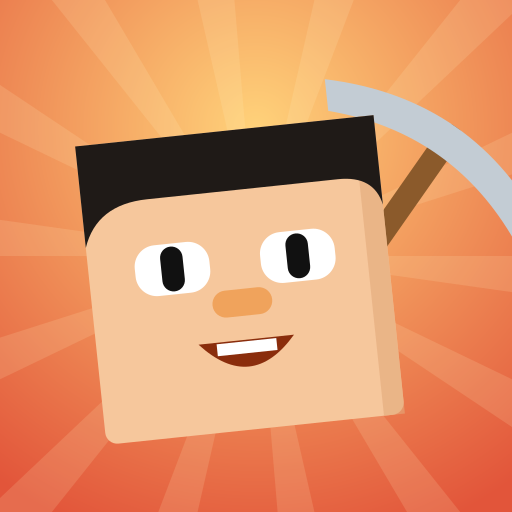

<p align="center">
  
</p>

<h1 align="center">Blockheads Club Website</h1>

<p align="center">
  The Blockheads Club website: downloads, guides and docs. 🌐
</p>

<p align="center">
  
  <a href="https://github.com/Blockheads-Club/website/releases"></a>
  <a href="https://github.com/Blockheads-Club/website/actions/workflows/ci.yml"></a>
  <a href="LICENSE"></a>
</p>

---

## 🚀 Project Status
**Current Status:** Live at [blockheads-club.github.io/website](https://blockheads-club.github.io/website/) (v0.1.0).

The site introduces the Blockheads Club tools, links their downloads and has
[guides](https://blockheads-club.github.io/website/guides/), an FAQ, the legal notice and the
[docs](https://blockheads-club.github.io/website/docs/). English, Turkish, Russian and Kazakh (picked from the browser language), light and dark theme.

---

## 📦 Other Blockheads Club Repositories
- [**blockheads-pc**](https://github.com/Blockheads-Club/blockheads-pc) - Play The Blockheads on your computer
- [**blockheads-patcher**](https://github.com/Blockheads-Club/blockheads-patcher) - Fix crashes and add small improvements to the game on your phone
- [**blockheads-server**](https://github.com/Blockheads-Club/blockheads-server) - Host your own Blockheads server for friends

---

## 🛠️ Requirements
**For contributors / development:** [bun](https://bun.sh). The site is SvelteKit 2 + Svelte 5 + TypeScript, built as
a static site.

---

## 🤝 Contributing
Everyone can open [issues](https://github.com/Blockheads-Club/website/issues) and pull requests, including fixes to
the guides and new translations. Irrelevant or abusive issues may be closed or removed.

### Development Guide
```bash
git clone https://github.com/Blockheads-Club/website.git
cd website
bun install
bun run dev        # dev server
bun run check      # svelte-check
bun run test       # vitest, 100% coverage
bun run test:e2e   # Playwright
bun run build      # static site in ./build
```

- **New language:** add `src/lib/i18n/<code>.ts` (typed as `Dict`, same keys as `en`, a test checks this), register it
  in `src/lib/i18n/index.ts` (`LOCALE_NAMES`, `DOCS_DIRS`) and add the code to the allow-list in the inline script of `src/app.html`.
  Counts use `Plural` objects picked with `Intl.PluralRules` (`plural()`). Scripts the site fonts lack get a
  `unicode-range` companion font (see `src/lib/fonts/cyrillic.css`: Onest and Golos Text for Cyrillic).
- **Deploy:** GitHub Pages (`pages.yml`, `BASE_PATH=/website`) and Cloudflare Pages (`cloudflare.yml`, project
  `blockheads-club`, needs `CLOUDFLARE_API_TOKEN` and `CLOUDFLARE_ACCOUNT_ID`, skipped without them).
- **Release:** push a signed tag `vX.Y.Z` on `dev` (version in `package.json`); `release.yml` builds
  `website-build.tar.gz` into a draft release, published once CI is green.

---

## 📄 License
The website is licensed under **GNU GPLv3 or later** (GPL-3.0-or-later). This program is free software: you can redistribute it and/or modify it under the terms of the GNU General Public License as published by the Free Software Foundation, either version 3 of the License, or (at your option) any later version. See the [LICENSE](LICENSE) file for details.

Unofficial fan project, not affiliated with Majic Jungle Software or Noodlecake Studios. No game files are
distributed here.
